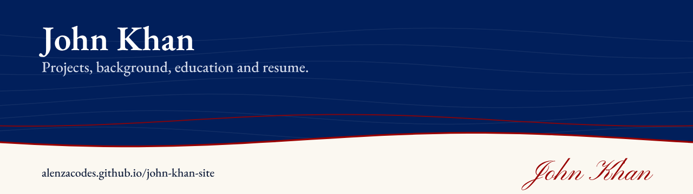
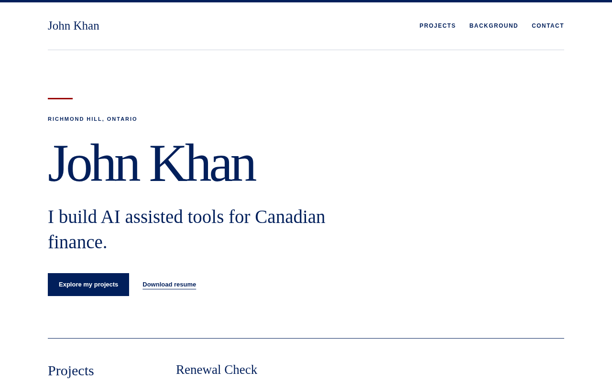

# John Khan: personal site

**My personal site: projects, background, education and resume.**

[](https://alenzacodes.github.io/john-khan-site/) [](LICENSE) 

Live: https://alenzacodes.github.io/john-khan-site/



## What it does

A one-page site with my projects, my background in Canadian financial services, my education and a link to download my resume.

## Quick start

No build step. Open `index.html` in a browser, or serve the folder:

```
python3 -m http.server 8000
```

## Files

```
index.html              the whole site
John_Khan_Resume.pdf    resume linked from the page
```

## Licence

MIT. Built by John Khan.

---

More of my work is on my [GitHub profile](https://github.com/ALENZACODES).
